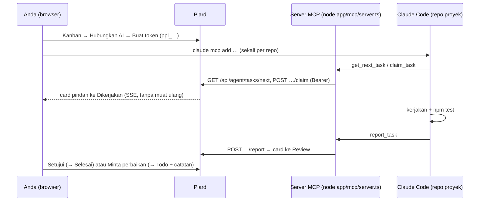

# Jembatan agen: Claude Code ↔ kanban Piard

Panduan memasang dan memakai jembatan agen (M8). Rancangan dan model ancaman ada di
[ADR 0017](adr/0017-jembatan-agen.md); kontrak HTTP di [api.md](api.md) (bagian `/api/agent/*`).

## Cara kerja



Server MCP hanya klien HTTP: ia tidak menyentuh database, jadi bekerja sama terhadap Piard lokal maupun
yang di-deploy (dengan `https://`).

## Memasang

1. Jalankan Piard (`pnpm dev` atau `pnpm build && pnpm start`).
2. Buka plan → **Kanban** → **Hubungkan AI** → isi nama token (mis. nama komputer) dan masa berlaku → **Buat
   token**. Token hanya tampil sekali.
3. Di folder repo proyek Anda, jalankan perintah yang disalin dari dialog, misalnya:

   ```bash
   claude mcp add --transport stdio piard \
     --env PIARD_URL=http://localhost:3000 \
     --env PIARD_TOKEN=ppl_… \
     -- node /jalur/ke/piard/app/mcp/server.ts
   ```

   Lingkup bawaan `local`: tersimpan di konfigurasi Claude Code Anda untuk repo itu, bukan di repo.
   Periksa dengan `claude mcp list` (harus `✔ Connected`).

   Alternatif yang aman di-commit: `.mcp.json` di akar repo yang membaca token dari variabel lingkungan.

   ```json
   {
     "mcpServers": {
       "piard": {
         "type": "stdio",
         "command": "node",
         "args": ["/jalur/ke/piard/app/mcp/server.ts"],
         "env": { "PIARD_URL": "http://localhost:3000", "PIARD_TOKEN": "${PIARD_TOKEN}" }
       }
     }
   }
   ```

   lalu `export PIARD_TOKEN=ppl_…` sebelum menjalankan `claude`. **Jangan** menulis token langsung di
   `.mcp.json`.
4. Opsional: isi **Instruksi proyek untuk agen** di dialog yang sama (perintah tes/lint, konvensi, folder
   terlarang). Instruksi ikut di setiap task.

Server MCP butuh Node ≥ 22.18 (menjalankan TypeScript langsung) dan `pnpm install` di `app/`. Ia gagal cepat
dengan pesan jelas bila `PIARD_URL`/`PIARD_TOKEN` kosong, token bukan `ppl_…`, atau `PIARD_URL` memakai
`http://` ke host selain localhost.

## Memakai

Di Claude Code ketik `/mcp__piard__work_next_card`, atau minta "kerjakan card berikutnya dari Piard". Agen:
`get_next_task` → `claim_task` → kerjakan → verifikasi → `report_task` → berhenti. Satu card per perintah;
satu task `doing` per token.

| Tool | Guna |
|---|---|
| `get_plan_overview` | ide, teknologi, instruksi proyek, progres, fitur |
| `list_tasks` | daftar task (saring status/fitur) |
| `get_next_task` | task yang masih dipegang, atau Todo berikutnya menurut roadmap |
| `get_task` | prompt, spesifikasi fitur, bagian PRD terkait, catatan (jawaban Anda, permintaan perbaikan) |
| `get_prd` | PRD terbaru |
| `claim_task` | Todo → Dikerjakan (idempoten) |
| `report_task` | Dikerjakan → Review dengan ringkasan, cara verifikasi, berkas diubah (idempoten) |
| `release_task` | Dikerjakan → Todo dengan alasan |
| `add_task_note` | catatan atau pertanyaan; pertanyaan menandai card "AI butuh jawaban" |

Di kanban: card agen bertanda **AI · label**; pertanyaan terbuka bertanda **AI butuh jawaban** (jawab lewat
**Detail**); card tanpa kabar > 2 jam bertanda **Mungkin macet** dengan tombol **Lepas**. Card Review punya
**Setujui** dan **Minta perbaikan** (catatan wajib, card kembali ke Todo dan agen membacanya di `get_task`).

## Uji nyata (2026-10-31)

Claude Code 2.1.314 (model bawaan) terhadap build produksi lokal (`LLM_MODE=mock`, DB sementara), repo Node
kecil tanpa dependensi, tiga card (slugify, titleCase, truncate), instruksi "jalankan `npm test`, jangan
commit". MCP didaftarkan dengan perintah persis dari dialog; `claude -p` dengan `--allowedTools
"mcp__piard,Read,Edit,Write,Glob,Grep,Bash(npm test:*)"`.

| Putaran | Perintah | Giliran | Waktu | Biaya | Hasil |
|---|---|---|---|---|---|
| 1 | `/mcp__piard__work_next_card` | 12 | 27 dtk | US$0,36 | slugify + 4 tes, `npm test` lulus, Review, berhenti |
| 2 | "Kerjakan card berikutnya dari Piard." | 11 | 25 dtk | US$0,33 | titleCase + tes, Review; perubahan card lain tidak disentuh |
| 3 | sama, setelah **Minta perbaikan** pada slugify | 10 | 26 dtk | US$0,32 | membaca catatan perbaikan, menambah tes `_`, Review |
| 4 | sama, card truncate (ambigu: `…` dihitung?) | 10 | 26 dtk | US$0,32 | memilih asumsi dan menulisnya di laporan, tidak bertanya |

Tidak ada transisi terlarang, tidak ada token di log server, tidak ada galat server. Penyesuaian dari putaran
4: alur kerja MCP kini meminta asumsi untuk ambiguitas kecil ditulis di ringkasan `report_task`, dan
pertanyaan disimpan untuk pilihan yang mengubah hasil secara berarti. Proyek Apps Script lewat `clasp`
belum diuji (tidak ada di mesin uji).
