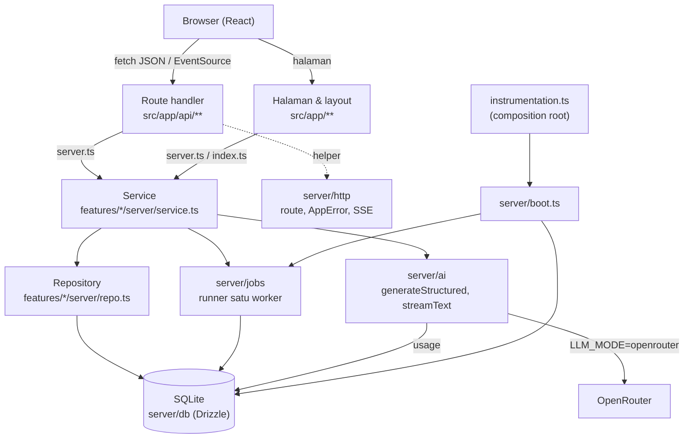

# Arsitektur

Modular monolith berbasis fitur dengan layer satu arah. Aturan di bawah ditegakkan alat
(`pnpm deps` = dependency-cruiser, `tests/unit/architecture.test.ts`, `server-only`), bukan ingatan.
Dasar keputusan: [ADR](adr/).

## Layer dan alur data

- **Route handler**: parse Zod → autentikasi → panggil service → JSON/SSE. Tanpa logika bisnis.
- **Service**: aturan bisnis, transaksi, orkestrasi AI/job. Dites tanpa HTTP.
- **Repository**: satu-satunya yang tahu tabel (`database-only-in-repo`).
- **Job**: handler idempoten yang menyimpan hasil per langkah dan bisa dilanjutkan setelah restart.
- **AI**: semua panggilan LLM lewat `server/ai` agar token dan biaya tercatat, batas biaya ditegakkan
  ([ADR 0012](adr/0012-batas-biaya.md)), dan mode `mock` berlaku. Model per tugas dan batas dibaca dari
  `server/settings` (`.env` ditimpa halaman Pengaturan, [ADR 0013](adr/0013-pengaturan.md)).

## Pintu fitur (deviasi dari doc 09 bagian 3)

Doc 09 menyebut `index.ts` sebagai satu-satunya pintu. Kenyataannya route handler butuh service,
sedangkan komponen klien tidak boleh menarik kode server. Maka setiap fitur punya **dua** pintu:

| Pintu | Isi | Boleh diimpor dari |
|---|---|---|
| `features/<f>/index.ts` | skema, tipe, teks, komponen (aman untuk klien) | mana saja di luar fitur |
| `features/<f>/server.ts` | service, guard, helper server (`import "server-only"`) | halaman, route handler, fitur lain |

Pengecualian kedua: route handler (`src/app/api/**`) boleh mengimpor `server/http` (helper route) selain
lewat `server.ts` fitur. Alasannya di [ADR 0006](adr/0006-feature-doors.md).

Fitur `codebase` (proyek eksisting, [ADR 0016](adr/0016-proyek-eksisting.md)) satu-satunya pemilik tabel
`codebases`, `codebase_docs`, dan `agent_tokens`. Fitur lain (`plans`, `questions`, `roadmap`, `prd`,
`specs`, `tasks`, `export`) hanya membaca konteks codebase lewat `features/codebase/server.ts`, tidak
pernah lewat tabelnya.

Fitur `agent-bridge` (jembatan agen MCP, [ADR 0017](adr/0017-jembatan-agen.md)) pemilik
`plan_agent_tokens` dan `task_notes`. Status dan klaim task tetap ditulis fitur `tasks` (agent-bridge
memanggil `claimForAgent`/`moveForAgent` lewat `tasks/server.ts`); plan, roadmap, PRD, dan sensor rahasia
(`codebase`) dibaca lewat `server.ts` masing-masing. Supaya `tasks` tidak bergantung balik, kanban menerima
slot (`KanbanSlots`) dan halaman kanban merender `AgentKanban` dari agent-bridge. Route `/api/agent/*`
memakai `agentRoute` (Bearer `ppl_…`, tanpa cookie); `authedRoute` tidak menerima token.

Server MCP (`app/mcp/`, di luar `src/`) adalah klien HTTP tipis untuk `/api/agent/*`, dijalankan
`node mcp/server.ts`. Aturan `mcp-is-http-client-only` melarangnya mengimpor `src/**`.

## Aturan impor (ringkas)

| Dari | Tidak boleh ke |
|---|---|
| halaman/layout `src/app/**` (kecuali `api/`) | `src/server/**` |
| `src/app/api/**` | `src/server/**` selain `server/http` |
| di luar fitur / antar fitur | internal fitur (hanya `index.ts`/`server.ts`) |
| `features/*/index.ts` | kode server |
| `components/`, `lib/`, `features/*/{components,hooks}` | kode server |
| `components/` | `features/` |
| `lib/` | bagian lain `src/` |
| `src/server/**` | `features/`, `app/`, `components/` |
| selain `src/server/**` dan `repo.ts` | `server/db`, `drizzle-orm`, `better-sqlite3` |
| `mcp/**` (server MCP) | `src/**` |
| siklus apa pun | — |

Di luar graf impor (`tests/unit/architecture.test.ts`): `process.env` hanya di `server/config/env.ts`
(dan `NEXT_RUNTIME` di `instrumentation.ts`); setiap berkas server mengawali `import "server-only"`;
tanpa `export default` kecuali konvensi berkas Next.

## Boot dan job

`src/instrumentation.ts` (composition root) memanggil `server/boot.ts`: memvalidasi env (gagal keras
dengan pesan jelas), menerapkan migrasi, mendaftarkan job handler fitur, lalu `recover()` mengantrekan
ulang job yang tertinggal `running` karena proses mati (maks. 3 percobaan). Fitur menyerahkan handler-nya
di `instrumentation.ts`, karena `server/` tidak boleh mengimpor fitur. Pekerjaan awal fitur juga dipasang
di sana (`startupTasks`, mis. menyapu sumber sementara proyek eksisting; dites lewat `register()` asli).

**Dua graf modul.** Next memuat `instrumentation.ts` dan route handler sebagai graf modul terpisah, jadi
modul yang sama bisa punya dua salinan dalam satu proses. Singleton (DB, job runner) disimpan di
`globalThis` agar tetap satu; kelas galat tidak bisa begitu, sehingga `AppError` memakai penanda
`Symbol.for` + `Symbol.hasInstance` (`server/http/errors.ts`). Tanpa itu, galat yang dilempar kode milik
runner (mis. `BUDGET_EXCEEDED` dari `admit` saat `enqueue`) tidak dikenali route dan menjadi 500 generik
(bug ditemukan e2e M7-22). Jangan mengandalkan identitas kelas/objek untuk nilai yang melintasi kedua graf.

## Pengujian

| Lapis | Lokasi | Catatan |
|---|---|---|
| Unit | `tests/unit` | fungsi murni, env, logger, kontrak token desain, arsitektur |
| Integrasi | `tests/integration` | SQLite di memori; AI lewat model palsu; route handler sungguhan |
| Kontrak | `tests/contract` | field respons situs acuan vs skema DB |
| E2E | `tests/e2e` | Playwright + Chrome terpasang, **build produksi**, DB terpisah, `LLM_MODE=mock` |
